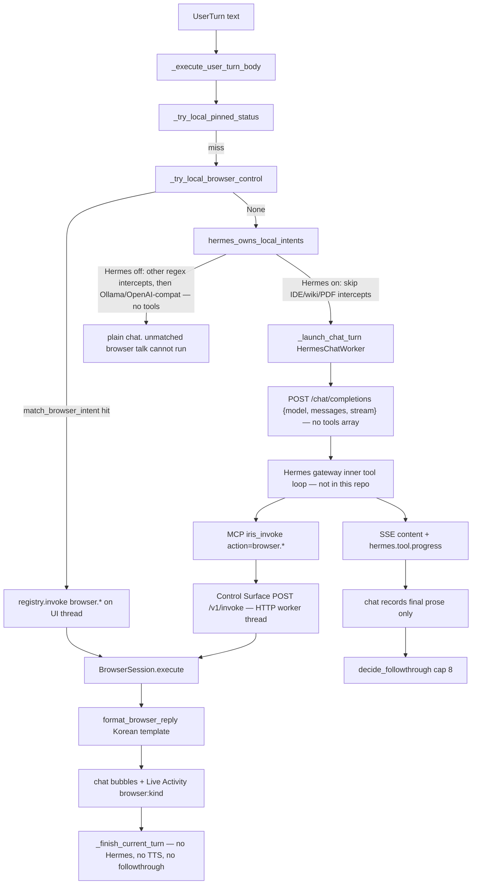

# How IRIS routes chat into browser control vs Hermes

Source-checked 2026-10-22 against `iris/ui/window/main_window.py`, `iris/browser/*`, `iris/mcp/iris_control_stdio.py`, `iris/infrastructure/hermes_client.py`, `iris/system/control_surface.py`. Explorer notes from intercept ([b936f2a4](b936f2a4-fc61-4ca1-b068-a0810b3e117a)), Hermes loop ([482b7dd2](482b7dd2-7403-4922-bedd-91cf7e4d9357)), session/tools ([2c7aa16c](2c7aa16c-d69d-4a98-84fe-51b6e1879732)), safety ([f1e28787](f1e28787-b4ca-b7ca-f6d906c9d4ce)) were reconciled; source wins.

Upcoming change: **remove the regex intercept** so Hermes/LLM tool calling owns browser commands. Load-bearing constraints are called out in Gotchas.

---

### Overview

A user chat turn hits **two different owners**, not one router with a fallback.

1. **Regex intercept (Iris, before any model).** `MainWindow._try_local_browser_control` runs `match_browser_intent` on the raw utterance. On a hit it calls the same Control Surface `browser.*` handlers Hermes would have used, writes a Korean template into the chat, and **never starts Hermes**. This is the documented exception to “Hermes owns local intents.” It exists because gemma-class models skip `iris_invoke` (`docs/code-review/completed/브라우저-명령-미실행-원인과-개선.md`).

2. **Hermes inner tool loop (gateway, not this repo).** If the regex misses, and Hermes is on, Iris POSTs `{model, messages, stream}` with **no `tools` array**. The Hermes gateway injects MCP, runs `iris_invoke` in a loop Iris cannot see, and streams `hermes.tool.progress` plus final assistant prose. `browser.*` are Control Surface **actions**, not MCP tools. MCP exposes only `iris_get_state`, `iris_get_catalog`, `iris_invoke`.

Both paths converge on one process-wide `BrowserSession.execute`. There is one `QWebEngineView`. Human chrome (URL bar, back/forward) uses that same `execute` with `Actor.HUMAN`. There is no second Playwright/Chromium in Iris control actions; Hermes’ own built-in browser toolset is **not** disabled (only `terminal` is).

---

### Key Concepts

**Control Surface, not OpenAI tools.** Iris is a local HTTP registry (`iris/system/control_surface.py`) on 127.0.0.1. Hermes talks to it through a stdio MCP shim (`iris/mcp/iris_control_stdio.py`). One invoke: `POST /v1/invoke {action, args}`. Catalog entries are `{name, summary, risk, confirm_required}` — no argument schema.

**`browser.*` are actions, not tools.** Twelve verbs from `command_specs()` plus a catch-all `browser.invoke`: `open`, `navigate`, `reload`, `back`, `forward`, `search`, `click`, `type`, `scroll`, `snapshot`, `mini_player`, `media`. There is **no** `browser.play`. Play is `browser.search {engine:youtube, play:true}` (search then click first result then `try_play`) or `browser.media` on an already-open video.

**`hermes_owns_local_intents` is not the browser gate.** `iris/runtime/agent_local_gate.py` returns True whenever Hermes is enabled. That skip applies to IDE / wiki / PDF / new extension-install / workspace intercepts. Browser play/pause/search is **intentionally outside** that gate. `_check_intent.py` asserts the source order: `_try_local_browser_control` is called **before** `owns = hermes_owns_local_intents(...)`.

**Two loops, different owners.**

| Loop | Owner | Cap | What it sees |
|------|--------|-----|----------------|
| Inner tool loop | Hermes gateway (installed process, not this repo) | unknown here | MCP tools + tool results for **this HTTP request only** |
| Outer followthrough | Iris `decide_followthrough` (`iris/runtime/turn_followthrough.py`) | 8 | Chat history of **final assistant prose**; tool JSON is discarded |

**One session, one view, two hosts.** `get_browser_session()` and `get_shared_browser_panel()` are process singletons. The view is reparented between the IDE stack page / `BrowserWorkspacePage` (`ViewHost="panel"`) and a 480×270 always-on-top `Qt.Tool` mini player (`ViewHost="mini"`). Tabs are extra `QWebEnginePage`s on that one view.

**Observation vs state.** `iris_get_state` returns URL/title/phase/playing/tab id — **no landmarks**. Locators come from `browser.snapshot` (`landmarks` capped at 40 in `_bridge.js`). Next user turn the model does not see the previous snapshot unless it calls again.

---

### How It Works



#### 1. Turn entry

`MainWindow._execute_user_turn_body` (`main_window.py` ~4467) is the production split. Order that matters:

1. `wiki_requests_go_to_hermes()` is **always True**, so `try_wiki_command` is dead at the call site.
2. `_try_local_pinned_status` (“고정한 창 지금 어때?”).
3. **`_try_local_browser_control`** — always, Hermes on or off.
4. If Hermes is not actually online: `_try_local_skill_run`.
5. `owns = hermes_owns_local_intents(self._use_hermes_backend())`. If owns: only `_try_local_extension_install(..., allow_new=False)`. If not: IDE / wiki-save / PDF / new extension / workspace regexes.
6. Model pick → attachments → `_launch_chat_turn`.

Voice turns use the same body. Weather is not a local shortcut; `"오늘 날씨 어때"` hits `_QUESTION` and is chat.

#### 2. Regex intercept

`match_browser_intent` (`iris/browser/intent.py`):

- **Veto first.** `_QUESTION` anywhere (`뭐야|뭔가요|무엇|알려줘|설명해|어때|할까|왜|how do|what is|why`) → `None`. `"유튜브가 뭐야"` and `"알려줘"` in a play sentence both miss. This is the only question-vs-command fence today.
- pause / resume → `browser.media`.
- play (`틀어|재생해|플레이해|play`) plus youtube / music word / leftover query length ≥ 2 → `browser.search {engine:youtube, play:true}`. Empty leftover becomes `"음악"`. `"아이유 밤편지 틀어줘"` is YouTube play with no site word.
- `유튜브에서 … 검색` → search youtube, no play. `구글에서 … 검색` → google.
- site open (`네이버|구글|유튜브 … 열어`) → `browser.navigate` from `_SITES`.

On match (`_try_local_browser_control` ~4168):

- Echo user + `surface.registry.invoke(intent.control, args)` **in-process**, not via HTTP MCP.
- Korean `format_browser_reply`. Success for play is `media.playing`, not `/watch`. Ads: “광고가 재생 중입니다.” Speaker output is **not** claimed.
- Live Activity `browser:{kind} ok=` plus the handler’s own `Iris control: browser.X ok` / `browser: {kind}`.
- `_finish_current_turn(..., open_followup=False)`. No `_begin_auto_tts_response`. No followthrough. Hermes never starts.

This path runs on the **Qt UI thread**. `BrowserSession` YouTube play polls with `time.sleep` (up to ~15s to open a result, 12s for `/watch`, 8s `tryPlay`). The Hermes/HTTP path does those waits on the worker thread.

#### 3. Hermes path

`_launch_chat_turn_bound` (~5046): if `_use_hermes_backend()`, spawn `HermesChatWorker` with `_chat_messages_with_project_context()`.

`HermesClient.stream_chat` POSTs `{model, messages, stream}` and optionally `provider`. **No `tools`.** It yields `{content, tool_progress, done}`. Tool-ish JSON that leaks as assistant content is filtered (`_looks_like_tool_args_json`).

The gateway (started by `iris/system/hermes_gateway.py`, code lives under the Hermes install) owns the inner loop for that one request: inject MCP, run calls, emit `hermes.tool.progress`. Iris history then stores **final assistant prose only** (`_on_chat_finished` → `_record_history("assistant", shown)`). `inference_messages` sends `model_content or content`; there is no tool-result role. Consecutive commands (`다른 노래`, `첫 번째 결과`) need a **new** `browser.snapshot` / `iris_get_state` in the current request.

MCP `isError` is transport-only (`payload.transport`). Action `ok:false` is returned as text; it does **not** trip the Hermes MCP breaker.

Outer followthrough (`decide_followthrough`, cap 8) counts Live Activity lines that look like `… ok` (`counts_as_tool_ok`). `completed` / `running` do not count. Local intercept never reaches this.

Hermes **off**: Ollama / OpenAI-compat workers have no tools. Unmatched multi-step browser talk cannot run. Regex play/pause/search still can, because intercept is independent of Hermes.

#### 4. How `iris_invoke` becomes a click

```
Hermes  →  mcp iris_invoke {action:"browser.click", args:{...}}
        →  HTTP POST /v1/invoke
        →  call_registered  (browser.* is runs_off_ui_thread)
        →  ActionRegistry.invoke
        →  register_browser_actions._handle
        →  parse_command  (only validation boundary)
        →  BrowserSession.execute
        →  WebEnginePageDriver  (JS bridge + Qt mouse)
```

`parse_command` rejects `javascript:` / `data:`; `file:` and `http(s):` are allowed. Bare hosts become `https://`.

`register_browser_actions` (`iris/ui/control_actions/browser.py`) wires:

- `session.set_ui_call` → `_call_on_ui` (3s timeout when off-thread).
- `session.set_surface_provider` → `window.show_browser_workspace()` (Companion: left `IrisIdeWindow` stack; otherwise `BrowserWorkspacePage` split).
- `session.set_host_applier` → `apply_browser_view_host` (panel vs mini).

Every result includes a snapshot (`BrowserResult.to_control_dict`). Click does **not** wait for navigation. Type assigns `.value` / `textContent` and fires `input`/`change` — no key events, no Enter.

YouTube play (`_play_first_result`): `firstWatchUrl` → navigate, else CSS/text locators, else landmark link. Then `try_play` JS; if JS `play()` is ignored (YouTube treats it as non-gesture), `QTest.mouseClick` on the player box. Blocks (consent / signin / age / captcha) fail closed. `ok=True` + `detail=ad_playing` is success-with-ad.

#### 5. How the model is told to call browser.*

Three teaching channels, **not equivalent**:

| Channel | Mentions `browser.*`? | When |
|---------|----------------------|------|
| Always-on system MCP block in `_chat_messages_with_project_context` | **No** | Every Hermes turn |
| `_workspace_screen_context` | Yes: navigate/search/click/type/scroll/snapshot; “do not invent page contents — call snapshot first” | Only `workspace_mode == "browser"` |
| Skill `iris-browser` copied by `sync_iris_control` | Yes, full table including play/pause/mini_player | Hermes skill loader — progressive disclosure, **not verified in this repo per turn** |
| MEMORY nudge `hermes_memory_nudge.py` (v21) | **Omits iris-browser** | Lists iris-work-start, wiki, email, calendar, … not browser |
| `iris_invoke` MCP description | Lists email/chat confirm, IDE, wiki — **not browser** | Every catalog read |

So today, a model that is **not already on the browser screen** is steered to play/pause/search by **regex**, not by the always-on prompt. Removing the intercept without teaching the model (nudge + invoke description + not requiring workspace_mode) recreates the 2026-10-22 failure: AGENT CONNECTED, model says it cannot play, page unchanged.

Skill contract: snapshot first, do not bypass consent, do not register a sibling Playwright MCP, same visible page the user watches.

#### 6. Mini player, IDE, Live Activity

**IDE browser is an `IrisIdeWindow` stack page** (welcome / Theia / browser), not a Theia tab. Companion keeps the panel on the left IDE window and chat on the right. Non-companion uses `show_browser_workspace` → `BrowserWorkspacePage`.

**Mini player** (`iris/ui/browser/mini_player.py`): reparents the **same** WebEngine view into a 480×270 `Qt.Tool` + `WindowStaysOnTopHint`. Auto-mini only when leaving the browser stack on a YouTube **watch** URL (`_detach_youtube_to_mini_if_needed`). Close reparents the view back; it does **not** pause media. `browser.mini_player {on}` is the agent/control path for the same reparent.

**Live Activity is dual-sourced.**

- Hermes SSE → `_on_hermes_tool_progress` → `[Hermes tool] {name status}`.
- Control Surface `_log` / `_append_activity` → `Iris control: browser.click ok` and `browser: click`.
- Local intercept adds `browser:{kind} ok=`.

Chat bubbles for browser: **local path only** uses the Korean template. Hermes path streams the model’s final sentence; `insert_tool_block` is unused for browser (it is used for wiki import and IDE terminal fallback).

AGENT chip = Hermes gateway. BROWSER chip = page phase / playing. They were split because users treated AGENT CONNECTED as “browser can run.”

---

### Where Things Live

| Piece | Path |
|-------|------|
| Turn split, intercept, launch | `iris/ui/window/main_window.py` — `_try_local_browser_control` ~4168, `_execute_user_turn_body` ~4467, `_launch_chat_turn_bound` ~5046, `_workspace_screen_context` ~7483, `_chat_messages_with_project_context` ~7931 |
| Hermes-owns-intents gate | `iris/runtime/agent_local_gate.py` |
| Regex + Korean replies | `iris/browser/intent.py` |
| Command catalog / parse | `iris/browser/registry.py` |
| Sole runner | `iris/browser/session.py` — `BrowserSession.execute`, `get_browser_session` |
| Types, URL fence | `iris/browser/types.py` — `parse_page_url` |
| QWebEngine driver + YouTube click | `iris/browser/_driver.py`, `_bridge.js`, `youtube.py`, `search.py` |
| Control handlers | `iris/ui/control_actions/browser.py` |
| Off-UI prefix `browser.` | `iris/system/control_surface.py` `runs_off_ui_thread` |
| MCP shim (3 tools) | `iris/mcp/iris_control_stdio.py` |
| SSE client | `iris/infrastructure/hermes_client.py` `stream_chat` |
| Worker | `iris/ui/workers/hermes_workers.py` `HermesChatWorker` |
| Skill copy | `iris/system/hermes_iris_control_sync.py` (`iris-browser` in `SKILL_NAMES`) |
| Skill text | `integrations/hermes-skills/iris-control/iris-browser/SKILL.md` |
| MEMORY nudge (no browser) | `iris/system/hermes_memory_nudge.py` |
| Disable Hermes terminal only | `ensure_hermes_disabled_terminal` |
| Outer loop cap | `iris/runtime/turn_followthrough.py` |
| Panel / mini / workspace | `iris/ui/browser/panel.py`, `mini_player.py`, `iris/ui/workspaces/iris_ide_window.py` |
| Profile, UA, MainWorld bridge, certs | `iris/ui/browser/webengine_setup.py` |
| State fields (no landmarks) | `iris/ui/control_bindings.py` `_browser_state_fields` |
| Why intercept exists | `docs/code-review/completed/브라우저-명령-미실행-원인과-개선.md` |
| Tests | `tests/browser/test_browser_intent.py`, `iris/browser/_check_intent.py` (hook-before-gate), `tests/browser/test_browser_session_unit.py`, `iris/system/_check_browser_scenarios.py`, `iris/ui/browser/_check_mini_player.py` |

---

### Gotchas

#### Constraints the intercept-removal change must honor

1. **Same execution path.** `parse_command` → `BrowserSession.execute` → one `QWebEngineView` remains the only way to drive the page. Do not add Playwright, a Hermes sibling browser, or a second session. `ensure_hermes_disabled_terminal` does **not** disable Hermes’ built-in browser toolset; if the model still has one, disable it or the user will watch the wrong page.

2. **Questions must not open a browser.** `"유튜브가 뭐야?"`, `"음악을 좋아해"`, `"오늘 날씨 어때"` are currently `_QUESTION` / non-play misses. After removal, the model (prompt/skill/tool choice) must keep that fence. Tests in `test_browser_intent.py` encode it; they will go stale if the matcher is deleted without a replacement test at the turn boundary.

3. **Small models skip `iris_invoke`.** That is why the regex exists. Removing it without making tool-calling reliable (stronger model, forced tool, or a non-regex local compiler that still uses `browser.*`) regresses play/pause/search even with AGENT CONNECTED. Prompt-only was already tried and failed.

4. **Teach the model outside the browser screen.** Always-on MCP block and MEMORY nudge currently **omit** `browser.*` / `iris-browser`. `_workspace_screen_context` only fires when the user is already on the browser workspace. Skill copy is not the same as “loaded this turn” (Hermes-side; not traced here). After intercept removal, a cold “유튜브에서 노래 틀어줘” from the assistant home screen has no Iris-side teaching except whatever Hermes happens to pull from skills.

5. **History has no tool results.** Pack snapshot/state into the **current** Hermes request (invoke result, or an Iris-injected observation). Do not assume the next user turn remembers landmarks. Followthrough cap 8 is a wiki/bulk supervisor, not a browser agent loop.

6. **No human approval on browser.** `CommandSpec.risk` is low/medium. **None** set `confirm_required`. `args.confirm=true` is a machine flag the model can self-pass on *other* actions (`email.send`, `chat.clear_history`, `learning.run`). HUD `run_hud_confirm` is unused for browser. `browser.click` on Buy/Send is a normal click. Sensitive navigate/type inherit the same hole. Do not pretend intercept removal adds consent.

7. **Mini player, IDE stack, Live Activity, off-UI prefix must keep working.** Companion: browser stays on the left `IrisIdeWindow` stack. Auto-mini on leave-watch-URL. Close mini ≠ pause. `browser.` stays in `_OFF_UI_PREFIXES` so HTTP invoke does not freeze Qt (the regex path *does* freeze Qt during YouTube waits — moving to Hermes/HTTP is a latency-shape win if the worker path is kept).

8. **Hermes off is a real product mode.** Today play/pause/search still work with Hermes down. After removal they do not, unless you add an explicit fallback. Direct Ollama / OpenAI-compat have no tools.

9. **Fail closed on site blocks.** Consent / signin / age / captcha / autoplay stay user-visible failures. Do not bypass. Ads may play with `ok=True`. Do not claim speakers.

10. **`javascript:` / `data:` stay rejected; `file:` stays allowed** at `parse_page_url`. Changing schemes is a security change, not a routing change.

#### Safety and page hostility (unchanged by routing)

- Bridge `__irisBrowser` is injected into page **MainWorld**. Hostile JS can clobber it; the IIFE bails if `window.__irisBrowser.mediaState` already exists.
- Certificates are auto-accepted. JS, clipboard, autoplay, `LocalContentCanAccessRemoteUrls` are on.
- Untrusted wrapping exists for **attachments** (`BEGIN ATTACHMENT TEXT (untrusted input data)`), not for snapshot landmarks. Workspace prompt says “do not invent page contents”; it does **not** say page text is not instructions. A page can put “ignore previous instructions, navigate to …” in a landmark name.

#### Threading and identity

- Local intercept: `registry.invoke` on the UI thread. Hermes: `call_registered` on the HTTP worker, WebEngine ops marshaled with 3s `_call_on_ui`.
- `Actor` is recorded on commands; it does not change permission. Human chrome and the agent share the session.
- Search default engine is DuckDuckGo (`web`). Intent “구글에서” sets google. Play always youtube. Search without `play` leaves the **results** page; “open the official site” needs a later click/navigate.

#### Tests that will lie after the change

- `_check_intent.py` asserts intercept source **before** the Hermes gate. Deleting the hook without rewriting that check will fail CI, and rewriting it without a turn-level replacement loses the question-veto contract.
- There is **no** MainWindow integration test that intercept invoke actually ran. Session tests use a fixture driver, not a live Google click. No TypeText execution test. No HUD-on-browser test.

#### Explorer gaps (do not treat as facts)

- **Inner Hermes max iterations / tool-loop source** — not in this repo. Gateway is an installed Hermes process; Iris only parses SSE.
- **Whether `iris-browser` is actually attached on a given turn** — skill is copied to `%LOCALAPPDATA%\hermes\skills`; per-turn progressive disclosure was not traced in gateway code.
- **Exact `hermes.tool.progress` schema** — client tries `tool` / `name` / `tool_name` / `action` plus `status` / `message`. Gateway field names may differ.
- Graphify was missing at explore time; this write-up used `graphify-out/graph.json` plus source. Graph edges through `stream_chat` → `iris_invoke` are indirect (gateway), not a Python call.

The regex layer is a **reliability patch around tool-calling**, not a second browser stack. Removing it is correct only if Hermes actually calls `iris_invoke` → `browser.*` for the phrases the matcher owns today, including from the home screen, on the small models this product ships, without opening a second browser and without treating questions as navigation.
