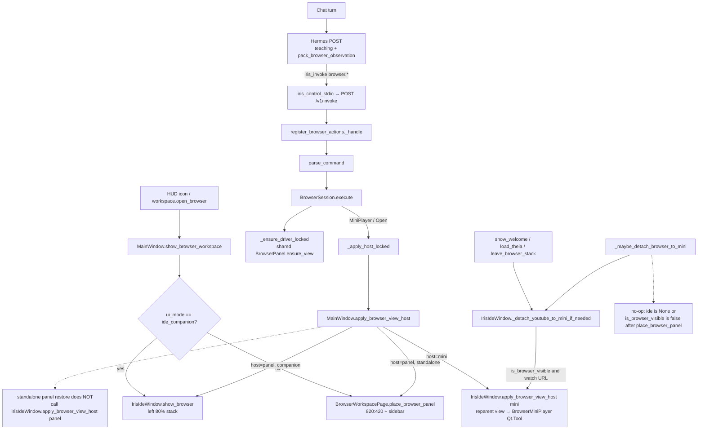

# How IRIS Hosts a Browser

Architectural walkthrough for a senior engineer. Source of truth is the code; explorer distillations were reconciled against it.

## Overview

IRIS does not embed a browser tab inside Theia. It owns one process-wide `BrowserSession` and one shared `BrowserPanel` whose `QWebEngineView` is the only page-driving Chromium. That view is *reparented* between two full-size hosts (standalone `BrowserWorkspacePage`, or the left pane of companion `IrisIdeWindow`) and a third chrome host (`BrowserMiniPlayer`, a `Qt.Tool` HWND). Theia keeps a *different* `QWebEngineView` on the same IDE window stack.

Chat never executes browser commands. With Hermes on, the model must emit `iris_invoke` → `browser.*`; the local regex intercept is gone and guarded. `Search(play=True)` plays YouTube on the existing view and does **not** flip `ViewHost`. Explicit `browser.mini_player` works. Auto-mini when leaving the standalone workspace is a no-op. Restoring from mini via the command path in non-companion mode can leave the view inside the Tool window.

## Key Concepts

- **`BrowserSession`** — process singleton (`get_browser_session`). Command bus. Holds the driver, `ViewHost`, last snapshot, last result.
- **`ViewHost`** — `Literal["panel", "mini"]` in `iris/browser/types.py`. Session bookkeeping only. Actual widget parenting is done by `IrisIdeWindow.apply_browser_view_host`.
- **`BrowserPanel`** — human chrome (tabs, URL bar, back/forward/reload) bound to `BrowserSnapshot`. Module singleton via `get_shared_browser_panel`.
- **`QWebEngineView` (`IrisBrowserView`)** — one view, many `QWebEnginePage`s (tabs). Mini reparents this view; it does not create a second browser Chromium.
- **`WebEnginePageDriver`** — JS-bridge driver over that view. Same object identity across reparent (`_check_mini_player._check_qt_reparent`).
- **`HostApplier`** — wired in `register_browser_actions` to `MainWindow.apply_browser_view_host`. `MiniPlayer` / `Open` call it through `_apply_host_locked`.
- **Panel hosts** — where the *panel widget* lives: `BrowserWorkspacePage` (HUD, 820:420) or `IrisIdeWindow._stack` (companion 80%).
- **Mini host** — `BrowserMiniPlayer`: `Qt.Tool | FramelessWindowHint | WindowStaysOnTopHint`, fixed 480×270. Not a chat-column PIP.
- **Theia view** — `IrisIdeWindow._view`, a second `QWebEngineView` on the same stack. Different profile, not driven by `BrowserSession`.
- **`iris_invoke`** — Hermes MCP tool. POST `/v1/invoke` → `ActionRegistry.invoke` → `session.execute`.

## How It Works

### One session, one panel, one browser view

`BrowserSession` starts with no driver. `register_browser_actions` (called when the control surface binds to `MainWindow`) installs three callbacks:

- `set_ui_call` — hop Qt work onto the UI thread (`_call_on_ui`). `browser.*` itself is classified off-UI (`control_surface.runs_off_ui_thread` prefix `browser.`).
- `set_surface_provider` — `MainWindow.show_browser_workspace`.
- `set_host_applier` — `MainWindow.apply_browser_view_host`.

The first command that needs a page calls `_ensure_driver_locked`. That asks the surface provider for the shared `BrowserPanel`, calls `panel.ensure_view()`, and wraps the result in `WebEnginePageDriver`. Subsequent commands reuse that driver. `_ensure_driver_locked` will call `_show_surface` again only when the driver already exists, `_visible` is false, and `_view_host == "panel"`.

`BrowserPanel.ensure_view` constructs exactly one `QWebEngineView`, names it `IrisBrowserView`, and configures it through `configure_browser_view` / `shared_browser_profile` (`~/.iris-light/browser-profile`, chrome-like UA, injected `_bridge.js`). Extra tabs are extra `QWebEnginePage`s on that same view (`setPage`). There is no second Iris-browser Chromium.

Theia is unrelated: `IrisIdeWindow._ensure_view` (around the `load_theia` path) creates `_view` as a different `QWebEngineView` on `_stack`. Two engines, two jobs.

### How a Hermes turn reaches `execute`

A user sentence in chat does **not** call `BrowserSession.execute`. The intercept (`match_browser_intent`, `_try_local_browser_control`, `iris/browser/intent.py`) is deleted. `_check_intent.py` asserts those strings stay gone and that `hermes_owns_local_intents` is a pure bool.

When Hermes is on, `_execute_user_turn_body` skips the remaining local regex routes (IDE / wiki-save / PDF / workspace) and launches the model. Every POST is packed by `MainWindow._chat_messages_with_project_context`:

1. `browser_teaching_block()` — names every `command_specs()` verb, teaches `iris_invoke browser.search {engine:youtube, play:true}`, vetoes question-shaped chats, forbids Hermes built-in `browser_*`.
2. `pack_browser_observation(get_browser_session())` — trusted Iris-owned block (phase, playing, last_action, url) plus `BEGIN PAGE TEXT` wrap for title/landmarks. Always on, including home-screen turns with a closed session.

Hermes built-in page-driving is disabled in `config.yaml` via `_merge_disabled_toolsets` (`terminal` + `browser`; `web` search/extract stays). The live check `_check_browser_hermes_play` may skip when the gateway or model is down. A skip is not a packer failure and must not restore regex.

The model must emit MCP `iris_invoke` with `action=browser.search` (etc.). `iris/mcp/iris_control_stdio.py` POSTs `/v1/invoke`. `ActionRegistry.invoke` runs `register_browser_actions._handle`:

- wire dict → `parse_command` → frozen `BrowserCommand`
- agent acts that look like send/pay/checkout go through `looks_sensitive_browser_act` + HUD (`ask_human`); `browser.search` / `media` / `mini_player` / `open` are never sensitive
- `session.execute(cmd)` → `BrowserResult.to_control_dict()`

Twelve verbs from `command_specs()`: `open`, `navigate`, `reload`, `back`, `forward`, `search`, `click`, `type`, `scroll`, `snapshot`, `mini_player`, `media`. There is no `browser.play`. YouTube is `browser.search` with `play:true` (click first watch result, `try_play`, success = `media.playing`) or `browser.media` `{action:play|pause|resume}` on the current page. `browser.invoke` is a generic wrapper that still goes through `parse_command`. `workspace.open_browser` only shows the workspace (sidebar-equivalent); it does not play media.

Human chrome on `BrowserPanel` *does* call `execute` (`Navigate` / `Reload` / `HistoryStep` with `Actor.HUMAN`). That is the URL bar and buttons, not the chat turn.

When Hermes is off, `_try_local_workspace_control` still matches home / mic / email / calendar / wiki phrases. It has **no browser route**. There is no local “유튜브에서 노래 틀어줘” path. The user can still open the surface from the HUD browser icon or `workspace.open_browser`.

### Two full-size hosts, one chat column

`MainWindow._body_stack` is the outer screen switch:

- index 0 — left sidebar + `_workspace_stack` (assistant, wiki, email, calendar, **browser**)
- `IdeCompanionPage` — also on the stack, used as a right-column widget
- `IdeUnifiedShell` — companion 80:20 (`_UNIFIED_IDE_RATIO = 0.8`)

`show_browser_workspace` branches on `_ui_mode`:

**Standalone (not companion).** Exit hero if needed. Stay on body-stack index 0. `place_browser_panel` reparents the shared panel onto `BrowserWorkspacePage` (calendar clone: splitter `[820, 420]`, left sidebar still visible). `note_surface_ready` so the next command does not force `IrisIdeWindow` to show. `_mount_workspace_chat` reparents the same orb / Live Activity / `ChatPanel` into `BrowserChatHost`.

**Companion.** `_show_browser_in_ide` does **not** exit companion. `reclaim_browser_panel` puts the panel back on `IrisIdeWindow._stack`, then `show_browser` → `apply_browser_view_host("panel")` so the left 80% shows BrowserPanel instead of Theia. Chat stays on the right `IdeCompanionPage`. There is no Theia browser tab.

The same `ChatPanel` instance moves. `addWidget` reparents; `setParent(None)` is forbidden (orphan `Iris Light` window).

Leaving browser:

- Companion → Theia/welcome: `return_from_browser` / `leave_browser_stack` / `show_welcome` / `load_theia` / `show_loading` all call `_detach_youtube_to_mini_if_needed`.
- Standalone → assistant/email/calendar/wiki: `_show_assistant_workspace` and the icon handlers call `_maybe_detach_browser_to_mini` *before* changing `_workspace_mode`.
- Browser icon → IDE (non-companion): `_on_browser_ide_requested` detaches then `_enter_ide_companion(source="browser")`.

`BrowserPanel.ide_requested` is connected in companion, but **nothing emits it**. There is no panel button that returns to Theia. Return is `IrisIdeWindow.return_from_browser` / `leave_browser_stack` from the IDE side.

Workspace ratio is not companion 80:20. Do not reuse `IdeUnifiedShell` math for `BrowserWorkspacePage`.

`build_cyberspace_qss` names `EmailWorkspacePage` / `CalendarWorkspacePage` and their chat hosts in the transparent+borderless group. `BrowserWorkspacePage`, `BrowserWorkspaceHost`, and `BrowserChatHost` are absent. Generic `QWidget { background-color: transparent }` still applies; the named-list gap is inconsistency, not a second engine.

### YouTube mini-player

`ViewHost` flips only through `_apply_host_locked` (`MiniPlayer`, and `Open` which forces `"panel"`). `Search` with `play=True` navigates, clicks a watch result, and `try_play`s. It never calls `_apply_host_locked`. Playing YouTube does not pop the mini by itself.

**Explicit mini.** `browser.mini_player {on:true}` → `MainWindow.apply_browser_view_host("mini")` → `_ensure_iris_ide_window()` → `IrisIdeWindow.apply_browser_view_host("mini")`: `panel.release_view()`, `mini.attach_view(view)`, `show_anchored`, if the IDE stack was on the panel it flips back to Theia/welcome, `note_view_host("mini")`. If the IDE window is hidden (typical standalone workspace), MainWindow still `ensure_browser_mini().show_anchored(self)` so the Tool window appears over the HUD.

**Auto-mini on IDE stack leave.** `_detach_youtube_to_mini_if_needed` requires `is_browser_visible()` — panel is the *current* widget on `IrisIdeWindow._stack` — and `is_youtube_watch_url`. That is true after `_show_browser_in_ide` / `show_browser`. `_check_mini_player._check_qt_reparent` covers this: leave watch → welcome, same `id(session._driver)`, mini visible.

**Auto-mini when leaving standalone workspace does not run.** `place_browser_panel` reparents the panel *off* the IDE stack (`BrowserWorkspacePage` comment: “panel may leave IrisIdeWindow stack”). Then `is_browser_visible()` is false. Also `_maybe_detach_browser_to_mini` returns immediately if `_iris_ide_window is None`, which is the common standalone case (`_check_browser_workspace` asserts the IDE window is None or hidden). The hook is called; the predicate never fires.

**Expand** on the mini title bar is `IrisIdeWindow.apply_browser_view_host("panel")` directly: detach view, hide mini, `panel.place_view`, show panel on the IDE stack if it still lives there. That path works.

**Command restore in non-companion is broken.** `browser.mini_player {on:false}` and `browser.open` go through `MainWindow.apply_browser_view_host("panel")`. That branch `place_browser_panel`s the chrome onto the workspace page and **never** calls `IrisIdeWindow.apply_browser_view_host("panel")`. The view can stay parented to the Tool window while the workspace shows an empty slot.

**Close** (`_on_mini_close`) parks the view back in the (possibly hidden) panel, hides the Tool window, `note_view_host("panel")`. It does not pause media and does not raise the panel.

**What the Tool window is.** `BrowserMiniPlayer` is a separate HWND (`Qt.Tool`), always-on-top, `setFixedSize(480, 270)`. Title-bar drag is `mouseMoveEvent` with no screen clamp and no follow of the parent window after `show_anchored`. It is not a widget inside `ChatPanel`.

### Implemented vs incomplete vs broken

| Status | What | Proof |
|---|---|---|
| Implemented | One shared panel + one browser `QWebEngineView` | `get_shared_browser_panel`, `BrowserPanel.ensure_view` |
| Implemented | Driver identity survives reparent | `_check_mini_player._check_qt_reparent` (`id(session._driver)` before/after) |
| Implemented | Separate Theia WebEngine on the same IDE stack | `IrisIdeWindow._view` vs `BrowserPanel._view` |
| Implemented | Command bus + 12 verbs, no `browser.play` | `command_specs`, `BrowserSession._execute_body` |
| Implemented | Hermes `iris_invoke` → `execute` | `iris_control_stdio._handle_tool`, `register_browser_actions._handle` |
| Implemented | Teaching + observation packer on every POST | `MainWindow._chat_messages_with_project_context` |
| Implemented | Regex intercept gone; gate is a bool | `_check_intent.main`, `hermes_owns_local_intents` |
| Implemented | Hermes built-in `browser` toolset disabled | `_merge_disabled_toolsets` |
| Implemented | YouTube via `search play:true` / `browser.media` | `Search` / `Media` in `_execute_body`, `_play_first_result` |
| Implemented | Explicit `browser.mini_player` reparents the view | `MiniPlayer` → `_apply_host_locked` → `IrisIdeWindow.apply_browser_view_host` |
| Implemented | Mini is `Qt.Tool`; drag / expand / close | `BrowserMiniPlayer.__init__`, `mouseMoveEvent`, `expand_requested`, `_on_mini_close` |
| Implemented | Auto-mini when leaving IDE stack on a watch URL | `_detach_youtube_to_mini_if_needed` from `show_welcome` / `load_theia` / `leave_browser_stack` |
| Implemented | Companion keeps 80:20 and does not exit | `_show_browser_in_ide` |
| Implemented | Standalone calendar-clone workspace | `BrowserWorkspacePage`, `show_browser_workspace` |
| Implemented | One `ChatPanel` reparented | `_mount_workspace_chat`, `IdeCompanionPage.mount` |
| Implemented | HUD icon + `workspace.open_browser` | `_on_browser_workspace_icon` |
| Incomplete | `Search(play=True)` does not flip `ViewHost` | `Search` branch in `_execute_body` (no `_apply_host_locked`) |
| Incomplete | Auto-mini after a later navigate to a watch URL | `Navigate` handler has no host change |
| Incomplete | Workspace auto-mini (leave standalone browser page) | `_maybe_detach_browser_to_mini` + `is_browser_visible` after `place_browser_panel` |
| Incomplete | Mini resize | `BrowserMiniPlayer.setFixedSize` |
| Incomplete | Drag clamp / follow parent | `mouseMoveEvent`, `show_anchored` (one-shot) |
| Incomplete | Chat-column PIP | `Qt.WindowType.Tool` in `BrowserMiniPlayer.__init__` |
| Incomplete | `ide_requested` never emitted | signal on `BrowserPanel`; no `.emit` in the repo |
| Incomplete | Browser hosts missing from named transparent QSS list | `build_cyberspace_qss` (email/calendar present, browser absent) |
| Incomplete | Hermes-off chat phrase → browser | `_try_local_workspace_control` has no browser route; intercept deleted |
| Incomplete | Tests for drag / resize / clamp / PIP / `media.playing` across host switch | `_check_mini_player` covers reparent + driver id only |
| Broken | Command restore-from-mini in non-companion leaves the view in the Tool window | `MainWindow.apply_browser_view_host("panel")` never calls `IrisIdeWindow.apply_browser_view_host("panel")` |

## Where Things Live

| File | Role |
|---|---|
| `iris/browser/types.py` | `ViewHost`, commands (`Open`…`MiniPlayer`/`Media`), `BrowserSnapshot` |
| `iris/browser/registry.py` | `command_specs`, `parse_command` |
| `iris/browser/session.py` | `BrowserSession`, `execute`, `_apply_host_locked`, `_ensure_driver_locked` |
| `iris/browser/_driver.py` | `WebEnginePageDriver` |
| `iris/browser/observation.py` | `pack_browser_observation`, `browser_teaching_block`, `looks_sensitive_browser_act` |
| `iris/browser/youtube.py` | `is_youtube_watch_url`, `page_block_reason` |
| `iris/browser/_bridge.js` | In-page snapshot / play / pause |
| `iris/ui/browser/panel.py` | Shared `BrowserPanel`, `ensure_view` / `release_view` / `place_view` |
| `iris/ui/browser/mini_player.py` | `BrowserMiniPlayer` |
| `iris/ui/browser/webengine_setup.py` | Named profile, UA, bridge injection |
| `iris/ui/control_actions/browser.py` | Wires session to MainWindow; registers `browser.*` |
| `iris/ui/control_actions/workspace.py` | `workspace.open_browser` |
| `iris/ui/window/main_window.py` | Screen switch, packing, `show_browser_workspace`, `apply_browser_view_host`, `_maybe_detach_browser_to_mini` |
| `iris/ui/workspaces/iris_ide_window.py` | Theia stack + real view reparent + auto-mini predicate |
| `iris/ui/workspaces/browser_workspace_page.py` | Standalone 820:420 host |
| `iris/ui/workspaces/ide_companion_page.py` | `IdeUnifiedShell` 80:20, `IdeCompanionPage` |
| `iris/mcp/iris_control_stdio.py` | `iris_invoke` → HTTP |
| `iris/system/control_surface.py` | Registry + off-UI `browser.*` |
| `iris/system/hermes_iris_control_sync.py` | Disable Hermes `browser` toolset |
| `iris/runtime/agent_local_gate.py` | `hermes_owns_local_intents` |
| `iris/browser/_check_intent.py` | Intercept-gone + packer + veto chats |
| `iris/ui/browser/_check_mini_player.py` | Reparent + driver id |
| `iris/ui/workspaces/_check_browser_workspace.py` | Workspace split + companion stay |
| `iris/system/_check_browser_hermes_play.py` | Live “did Hermes emit iris_invoke?” — skip ≠ restore regex |

## Gotchas

**Regex must stay gone.** `_check_intent.py` fails the build if `match_browser_intent`, `_try_local_browser_control`, or `iris/browser/intent.py` come back. `_check_browser_hermes_play` skipping (gateway down / model missing) is the 2026-10-22 incident class, not a reason to intercept locally. Teaching + packer are the only chat→browser lever.

**Two WebEngines.** Theia (`IrisIdeWindow._view`) and the Iris browser (`IrisBrowserView`) are different Chromium instances with different profiles. Do not drive Theia with `BrowserSession`. Do not assume one `QWebEngineView` on that window is “the browser.” Mini does not create a third Chromium; it reparents the browser view.

**Workspace auto-mini is a no-op.** `_maybe_detach_browser_to_mini` is invoked when leaving the standalone browser page, but it needs an existing `IrisIdeWindow` and `is_browser_visible()`. After `place_browser_panel`, the panel is not on the IDE stack, so the watch-URL check never runs. Auto-mini is real only for companion / `show_browser` (panel current on `_stack`).

**Mini is `Qt.Tool`, not chat PIP.** It is a second top-level HWND, always-on-top, fixed 480×270. It is not a child of `ChatPanel` and does not tile with the 80:20 or 820:420 split.

**Restore-from-mini in non-companion.** The expand *button* calls `IrisIdeWindow.apply_browser_view_host("panel")` and works. Agent `browser.mini_player {on:false}` / `browser.open` call `MainWindow.apply_browser_view_host("panel")`, which only `place_browser_panel`s chrome and does not steal the view back from the Tool window.

**No resize.** `setFixedSize`. Drag is unconstrained. `show_anchored` does not subscribe to parent moves. Close parks the view and does not pause.

**`Search(play=True)` is not a host switch.** Playback stays in whatever host already holds the view. If you want mini after play, something else must issue `MiniPlayer` or leave an IDE stack page that currently shows the panel on a watch URL.
