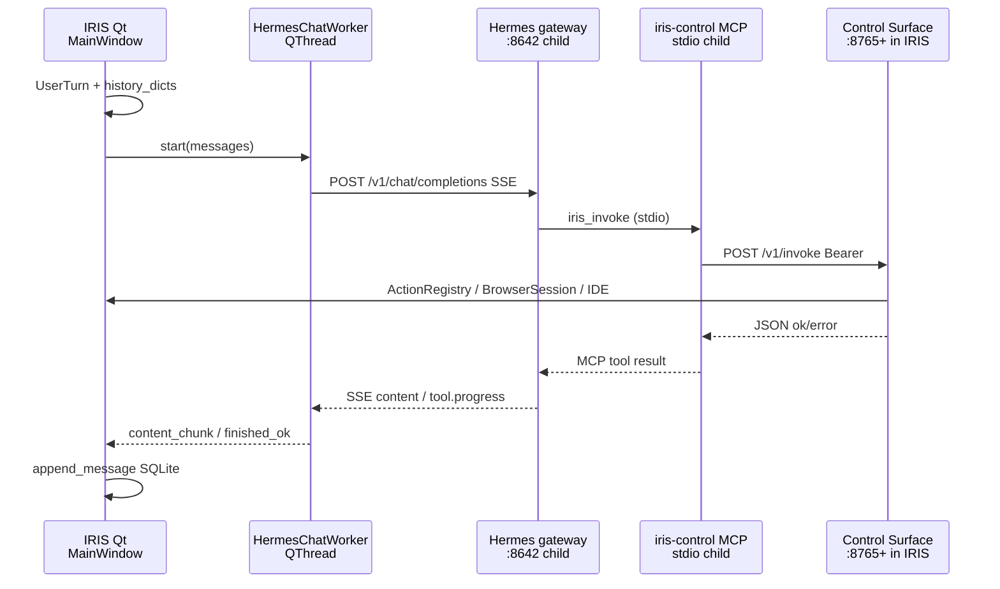

# How IRIS runs Hermes Agent

How IRIS currently runs Hermes Agent, and where an in-process or IRIS-owned internal engine could attach without rewriting chat, UI, or tools.

Verified against source on 2026-10-27. Local Hermes checkout inspected at `%LOCALAPPDATA%\hermes\hermes-agent`.

---

### Overview

IRIS does not import Hermes. It installs a separate Python tree under `%LOCALAPPDATA%\hermes`, starts a hidden child (`venv python -m hermes_cli.main gateway run --quiet --accept-hooks`) on `127.0.0.1:8642`, and talks to it as an OpenAI-compatible HTTP server. A chat turn is an IRIS `UserTurn`: SQLite history is rebuilt into `messages` and POSTed as SSE to `/v1/chat/completions`. Tools never go through Hermes' own terminal or browser. Hermes sees three MCP tools (`iris_get_state`, `iris_get_catalog`, `iris_invoke`); invoke is HTTP back into IRIS's Control Surface on `127.0.0.1:8765+`.

That isolation is deliberate. The gateway outlives IRIS close. Restart is stop-then-start, not `--replace`. Env pollution from IRIS's `.venv` is stripped before spawn. LICENSE.md §3.4 keeps Hermes unbundled so its license does not propagate — even though the upstream license is MIT and would allow vendoring if the notice is kept. An "internal engine" can attach at install/lifecycle, at the HTTP client, or as a same-process `AIAgent` import. The three options do not rewrite the same things, and they do not fail the same way.

---

### Key Concepts

- **Hermes gateway** — aiohttp OpenAI-compat API in a child process. Alive check is unauthenticated `GET /health`. Chat-ready is `GET /v1/models` with Bearer `API_SERVER_KEY`. Chat itself is `POST /v1/chat/completions`.
- **Hermes home** — on Windows, `%LOCALAPPDATA%\hermes` (`iris.infrastructure.hermes_credentials.hermes_home`). Docs and Unix default say `~/.hermes`. Upstream `get_hermes_home()` uses the same Windows rule. IRIS also sets `HERMES_HOME` on the child.
- **Control Surface** — IRIS-local HTTP on `127.0.0.1:8765` (tries +10 ports). Bearer `IRIS_CONTROL_TOKEN`. This is the tool plane. Hermes never calls Qt directly.
- **iris-control MCP** — stdio JSON-RPC child that Hermes spawns. Three tools. Each call is HTTP to Control Surface. Entry script lives in `~/.iris-light/hermes-mcp/`, not under a PyInstaller `_MEI` path.
- **Hermes-on** — `Settings.hermes_enabled` defaults True. When on, Ollama names and `api:{id}:{model}` both go through the gateway. `settings.set` refuses to turn it off because tools exist only on this path.
- **AIAgent** — upstream public API (`from run_agent import AIAgent`) inside the Hermes venv only. IRIS never imports it.

---

### How It Works

#### Install (not vendored)

`SetupProtocol` (`iris/system/setup_protocol.py`) runs `hermes_install` → `hermes_env` → `hermes_provider` → `hermes_gateway` during first-run / repair. `_step_hermes_install` tries the official `install.ps1` from `https://hermes-agent.nousresearch.com/install.ps1`, then falls to `install_hermes_with_system_python` in `iris/system/hermes_install.py`.

The bypass clones `https://github.com/NousResearch/hermes-agent.git` into a staging dir under `%LOCALAPPDATA%\hermes`, then rename-swaps it to `hermes-agent`. Source is not in the IRIS repo. LICENSE.md §3.4 states this on purpose: IRIS "설치·기동·HTTP 호출만 하고 소스를 포함하지 않" so upstream terms do not spread into IRIS.

The tree on disk today is MIT (Nous Research 2025). `pyproject.toml` says `license = "MIT"`. MIT would allow vendoring if the copyright notice stays. That is a policy/isolation choice, not a legal block.

Python is the sharp edge. Upstream `requires-python` is `>=3.11,<3.15`, but core deps are marked `python_version >= '3.14'` and the package comment says they only support 3.14 now (older Pythons are allowed through so an update can finish). `hermes_python_range()` reads the checkout's `pyproject.toml` / `uv.lock` and narrows to the intersection. A 3.11 venv can look installed and still have no `ruamel` / `aiohttp`.

#### Gateway lifecycle (IRIS already owns start/stop/restart)

`hermes_gateway.py` is the process manager.

1. `hermes_executable()` / `_hermes_runtime_python()` find `%LOCALAPPDATA%\hermes\hermes-agent\venv\Scripts\python.exe` (or a committed install under `hermes\installs\*\facts.json`).
2. `_build_gateway_cmd()` prefers `python -m hermes_cli.main gateway run --quiet --accept-hooks`. It does not pass `--replace`.
3. `_gateway_child_env()` copies `os.environ`, strips `VIRTUAL_ENV` / `PYTHONPATH` / uv / conda keys, then sets `HERMES_HOME`, `HERMES_ACCEPT_HOOKS=1`, `HERMES_DISABLE_LAZY_INSTALLS=1`, and the Hermes `.env` (`API_SERVER_ENABLED`, `API_SERVER_HOST=127.0.0.1`, `API_SERVER_PORT=8642`, `API_SERVER_KEY`).
4. `_popen_hidden()` uses `CREATE_NO_WINDOW` only. `CREATE_NEW_PROCESS_GROUP` is documented as killing the gateway within seconds on Windows.
5. `ensure_hermes_gateway_running()` is the public "make it ready" call. If `/health` is up it still requires `probe_gateway_ready()` (`/v1/models`). Health-only zombies get `stop_hermes_gateway()` then a fresh start. Ready means `/health` + `/v1/models`, not chat auth.
6. `restart_hermes_gateway()` is stop-all + wait for `/health` down + start. Comment in source: `--replace` left a lock-holding old process (MCP 0 tools) while the new one died.
7. `stop_hermes_gateway()` runs `hermes gateway stop --all`, then taskkill, then stale `gateway.lock` removal.

`MainWindow.closeEvent` stops Control Surface, chat workers, TTS, IDE. It does **not** call `stop_hermes_gateway`. The child outlives IRIS. Next launch is a health probe, not a guaranteed cold start.

`HermesHealthWorker.run()` (QThread, never the UI slot) is the boot path: `ensure_hermes_provider_config()` → `sync_iris_control(reconnect_gateway=True)` → optional `restart_hermes_gateway()` → `verify_iris_mcp_tools()` (`hermes mcp test iris-control`). Setup's `_warm_core_services()` also calls `ensure_hermes_gateway_running()`.

Lifecycle calls share `_GATEWAY_LIFECYCLE_LOCK`. Concurrent health/model/chat workers must not start two gateways.

#### Auth: three different answers

| Probe | Auth | Meaning |
|---|---|---|
| `GET /health` (also `/v1/health`) | none | Process alive. `HermesClient.probe_health`. |
| `GET /v1/models` | Bearer `API_SERVER_KEY` | API server mounted and key present. `probe_gateway_ready`. |
| `POST /v1/chat/completions` | Bearer | Chat. `probe_chat_auth` / `stream_chat`. |

`resolve_hermes_api_key()` prefers `%LOCALAPPDATA%\hermes\.env` `API_SERVER_KEY` over the IRIS settings field. A Connected indicator from `/health` or even `/v1/models` can still 401 on send. `is_hermes_gateway_running(..., timeout_sec=3)` is health-only (settings ping). Without `timeout_sec` it is ready (`/health` + `/models`).

`/v1/models` 404 is its own diagnosis (`CODE_MODELS_404`): wrong base path (`/models`, `/v1/v1/models`) looks like a key problem and is not.

#### Chat turn (IRIS owns history; Hermes is stateless HTTP)

Default `hermes_enabled=True`. Send goes:

1. Composer → `UserTurnDispatcher` → `UserTurn` (`iris/runtime/user_turn.py`). `session_id` here is the IRIS SQLite conversation id, not a Hermes session.
2. `MainWindow._execute_user_turn` → `_execute_user_turn_body`. If Hermes-on, `hermes_owns_local_intents(True)` skips most local regex intercepts (IDE / wiki / PDF / workspace). The model is supposed to `iris_invoke`.
3. `_continue_user_turn_bound` records the user row via `append_message` (`iris/storage/conversations.py`).
4. `_with_past_chats` may attach wiki / past-chat / web blocks, then `_launch_chat_turn_bound`.
5. `_chat_messages_with_project_context()` loads `history_dicts(db, conversation_id)` (or the bound slot's history), runs `inference_messages()` (uses `model_content` when present), and prepends a large system-ish instruction block: MCP tool names, `project.run` not Hermes terminal, citations, learning, wiki. Hermes path does **not** inject SOUL.md here — Hermes already loads `HERMES_HOME/SOUL.md` as identity.
6. If `_use_hermes_backend()`: `resolve_hermes_inference(model, db, ollama_base_url)` on the UI thread (reads API-provider rows). Then `HermesChatWorker(...)`.
7. Worker is a `QThread`. `_ensure_gateway()` calls `ensure_hermes_gateway_running()`. Failure emits `failed` with the diagnosis. It does **not** construct `OllamaChatWorker`. Hermes-on has no backend fallback to Ollama.
8. `HermesClient.stream_chat()` POSTs `{model, messages, stream: true}` (optional `provider`) to `{base}/chat/completions` with `Authorization: Bearer …`. No Hermes `session_id`. No conversation handle. Full `messages` every turn.
9. SSE: `delta.content` → `content_chunk`; `event: hermes.tool.progress` → `tool_progress`; `[DONE]` → `finished_ok`. Tool-args JSON leaked as assistant content is filtered (`_looks_like_tool_args_json`).
10. MainWindow slots persist the assistant row and finish the turn. Worker exceptions stay in `run()` and become `failed.emit(...)`. They do not escape into a Qt slot (that path is `0xC0000409` / `qFatal`).

Cancel is `HermesChatWorker.request_cancel()` setting `self._cancel = True`. The SSE loop checks the flag between lines. `urlopen` is not closed. In-flight MCP / tool work on the Hermes side is not aborted.

`_hermes_fallback_attempts` is model failover **through the same gateway** (quota / 5xx → next `ChatAttempt`). `decide_fallback` does not switch to `OllamaChatWorker`. Gateway-down is not a fallback reason.

Ollama as a model is `provider: custom` + `http://127.0.0.1:11434/v1`, not `ollama-cloud`. `infer_hermes_provider` maps local names to `ollama`, then `set_inference_model` rewrites that to `custom`. Cloud `*:cloud` still goes through local Ollama as proxy.

#### Tools (three MCP names, one HTTP control plane)

`start_control_surface(window)` (`iris/ui/control_bindings.py`) builds `ControlSurface` on `127.0.0.1:8765` (bind walks +10), writes `~/.iris-light/control_{host,port,token}`, registers actions (`_register_actions`). `closeEvent` calls `stop_control_surface`.

`sync_iris_control()` (`iris/system/hermes_iris_control_sync.py`) upserts `iris-control` into `%LOCALAPPDATA%\hermes\config.yaml` and copies skills into Hermes' skills dir. The MCP command is IRIS `.venv\Scripts\python.exe -u ~/.iris-light/hermes-mcp/iris_control_stdio_entry.py` — never `IRIS.exe` / `_MEI`. `ensure_hermes_disabled_terminal()` merges `agent.disabled_toolsets: [terminal, browser]`. The Hermes `web` toolset (search/extract) stays on. File and shell go through `iris_invoke` → `project.write_file` / `project.run` (IDE integrated terminal, path jail). Those actions do not use the HUD confirm path; high-risk HUD is for things like `email.send` and `chat.clear_history`.

`iris/mcp/iris_control_stdio.py` is a no-SDK NDJSON MCP server. Exactly three tools:

- `iris_get_state` → `GET /v1/state`
- `iris_get_catalog` → `GET /v1/catalog`
- `iris_invoke` → `POST /v1/invoke` `{action, args}`

HTTP uses Bearer `IRIS_CONTROL_TOKEN`. Execution errors return `ok: false` with `isError` off (Hermes treats `isError` as a connection breaker). Transport failures set `isError`.

`ControlSurface.invoke` looks up `ActionRegistry`, optionally `ask_human` for `confirm_required`, then runs the handler. UI-touching actions marshal through `MainThreadInvoker` → `_QtInvoker`. `runs_off_ui_thread` (browser.*, emulator.*, `project.run`, IMAP, wiki import, …) runs on the HTTP worker so Qt does not freeze.

Browser / YouTube / mini-player go through `BrowserSession` (`iris/browser/session.py`) and `register_browser_actions`. Hermes' own page-driving `browser` toolset is the one that is disabled.

`mobile-mcp` is a second MCP **server** sync may also write. That does not add tools to the iris-control surface. Hermes can therefore advertise more than three tools total; iris-control itself is three.

#### Upstream Hermes (present on disk, unused as a library)

Local tree: `%LOCALAPPDATA%\hermes\hermes-agent`, MIT, public API:

```python
from run_agent import AIAgent
agent = AIAgent(...)
agent.run_conversation("...")
```

`AIAgent.__init__` accepts `session_id`, toolset enable/disable, callbacks for stream/tool/thinking, and forwards to `agent.agent_init.init_agent`. The gateway HTTP server is a separate process that wraps this loop. IRIS never imports `run_agent` or `AIAgent`. A search of `iris/` has no such import.

Hermes has its own SQLite+FTS5 sessions. IRIS does not send a session id, so that store is not the chat history the user sees. IRIS SQLite is.

#### Where an internal engine attaches

Do not pick a product winner. These are attach points the current seams already make.

**(a) Keep child HTTP; make install/lifecycle IRIS-owned**

Attach: `hermes_install.py`, `SetupProtocol._step_hermes_install` / `_step_hermes_gateway`, `hermes_home()`, `_build_gateway_cmd()`, `ensure_hermes_gateway_running()`, `MainWindow.closeEvent`.

Chat, UI, and tools stay. `HermesClient.stream_chat`, `HermesChatWorker` signals, `iris_control_stdio`, Control Surface do not change if the child still speaks `/health`, `/v1/models`, `/v1/chat/completions` (plus `hermes.tool.progress` if you want the same HUD lines).

What you would own: pin/SHA, home directory (`~/.iris-light/engine` vs `%LOCALAPPDATA%\hermes`), whether close kills the child, whether official `install.ps1` remains a fallback.

What breaks: every reader of `HERMES_HOME` / `config.yaml` / `.env` / `SOUL.md` / skills / `hermes mcp test`; users with an existing `%LOCALAPPDATA%\hermes` tree; LICENSE.md §3.4 if you vendor into the repo (policy text must change; MIT notice must be kept). Kill-on-close trades a warm gateway for a cold start every launch. `restart_hermes_gateway` and MCP reconnect stay necessary as long as tools are a stdio child of that process.

**(b) Import `AIAgent` in-process**

Attach: `HermesChatWorker.run()` / `HermesClient.stream_chat()`. Map `content_chunk` / `tool_progress` / `request_cancel` onto `AIAgent` callbacks (`stream_delta_callback`, `tool_progress_callback`, interrupt mixins). Control Surface and MCP HTTP can stay if `AIAgent` still loads `iris-control` from `config.yaml`, or you pass IRIS tools in some other registry.

What you keep: ChatPanel, UserTurn, SQLite history, action catalog, BrowserSession.

What breaks:

- Crash domain. Hermes exceptions, native deps, and Qt `qFatal` share one process. Worker `try/except` only covers what `run()` wraps.
- Env pollution. `_gateway_child_env()` exists because IRIS `VIRTUAL_ENV` made `hermes.exe` re-exec a broken base Python. In-process import uses IRIS's interpreter. Upstream pins want 3.14; IRIS's `.venv` is not that tree.
- Restart. `restart_hermes_gateway` (up to 60s, MCP re-attach) becomes "reload the agent in the GUI process" or "restart IRIS". `HermesHealthWorker` / `HermesControlSyncWorker` assume a child they can kill.
- Session semantics. `AIAgent` wants `session_id` and its own DB. IRIS resends full `messages`. You must pick one memory, or you get two.
- Cancel. Today a flag. In-process you could interrupt the loop; you also block a QThread with CPU/tool work and can freeze the worker until the current tool returns.
- License isolation in §3.4 is about not shipping the source. Importing from `%LOCALAPPDATA%` is still not a bundle, but it is no longer a separate crash/license process.

**(c) Other seams the code already has**

1. **Swap the child argv only.** Change `_windows_hidden_cmd()` / `_build_gateway_cmd()` to launch an IRIS-owned binary that still implements the OpenAI-compat gateway + MCP attach. Client, workers, MCP stdio, Control Surface stay. Breaks: `hermes` CLI (`config set`, `mcp test`, `gateway stop --all`), `verify_iris_mcp_tools`, `set_inference_model` CLI fallback, SOUL.md / config.yaml schema if the new engine does not read them.
2. **New backend name beside hermes/ollama/api.** `resolve_backend_route()` and `_launch_chat_turn_bound` are the branch. A worker with the same signals (`content_chunk`, `tool_progress`, `finished_ok`, `failed`, `request_cancel`) plugs into `_start_chat_worker` without ChatPanel changes. Breaks anything that assumes `hermes_enabled` means "the :8642 child exists" (`_refresh_hermes_health`, `hermes_owns_local_intents`, settings.set).
3. **Engine talks Control Surface only.** Any agent that can `GET /v1/state|catalog` and `POST /v1/invoke` gets IDE, browser, wiki, mail, learning. Chat UI still needs *some* stream adapter. This is the cheapest tool attach and is already the contract Hermes uses.



Three processes on the tool path: IRIS (Qt + Control Surface thread), Hermes gateway, MCP stdio. Ollama on `:11434` is a fourth process when the model is local. It is the inference backend, not the agent.

---

### Where Things Live

| Path | Role |
|---|---|
| `iris/system/hermes_gateway.py` | Detect, spawn, health, restart, stop, diagnosis, `verify_iris_mcp_tools` |
| `iris/system/hermes_install.py` | Official-ps1 bypass: staging clone, Python range, venv |
| `iris/system/setup_protocol.py` | First-run steps: install, `.env` key, provider, gateway warm |
| `iris/infrastructure/hermes_credentials.py` | `hermes_home()`, `.env`, `resolve_hermes_api_key` |
| `iris/infrastructure/hermes_client.py` | HTTP adapter: health / ready / chat SSE / model set |
| `iris/ui/workers/hermes_workers.py` | `HermesHealthWorker`, `HermesControlSyncWorker`, `HermesModelSyncWorker`, `HermesChatWorker` |
| `iris/ui/window/main_window.py` | Turn lifecycle, `_launch_chat_turn_bound`, close (no gateway stop) |
| `iris/runtime/user_turn.py`, `user_turn_dispatcher.py` | Turn queue |
| `iris/runtime/backend_route.py` | hermes-on → gateway for every model |
| `iris/storage/conversations.py` | SQLite `conversations` / `chat_messages`; `history_dicts` |
| `iris/system/hermes_iris_control_sync.py` | `config.yaml` MCP upsert, disable terminal/browser, skills |
| `iris/mcp/iris_control_stdio.py` | Three-tool MCP → Control Surface HTTP |
| `iris/system/control_surface.py` | `:8765+` registry + HTTP |
| `iris/ui/control_bindings.py` | `start_control_surface`, action registration, Qt marshal |
| `iris/browser/session.py` | `BrowserSession` for pages / YouTube / mini-player |
| `iris/config/settings.py` | `hermes_enabled=True`, `:8642/v1` |
| `LICENSE.md` §3.4 | Do not bundle Hermes |
| `%LOCALAPPDATA%\hermes\` | Home: `.env`, `config.yaml`, `hermes-agent\`, `logs\iris-gateway\` |
| `%LOCALAPPDATA%\hermes\hermes-agent\run_agent.py` | Upstream `AIAgent` (not imported) |

---

### Gotchas

- **`~/.hermes` vs `%LOCALAPPDATA%\hermes`.** Docs and Unix use `~/.hermes`. Windows IRIS and upstream both use `%LOCALAPPDATA%\hermes` when `LOCALAPPDATA` is set. `HERMES_HOME` on the child makes the two agree. A tool that writes `~\.hermes` on Windows is writing the wrong tree.
- **LICENSE.md vs MIT.** §3.4 is product policy (unbundled so licenses do not propagate). Upstream is MIT; vendoring is legally possible with notice. Importing `AIAgent` in-process is a crash/env decision first, a license-doc decision second.
- **`/health` is not chat-ready.** Alive ≠ key ≠ models route ≠ chat 200. `probe_chat_auth` exists because `/v1/models` has been seen returning 200 with a bad or missing key.
- **Process outlives IRIS.** Close stops Control Surface. Hermes keeps serving `:8642`. MCP then fails with "Start Iris Light first" until IRIS is back — unless you also change `closeEvent`.
- **No `--replace`, no `CREATE_NEW_PROCESS_GROUP`.** Both were production failures on Windows. New work that "just" adds those flags will regress.
- **Hermes-on does not fall back to Ollama.** Gateway start failure is a chat error card. `_hermes_fallback_attempts` only rotates models through Hermes. `settings.set` rejects `hermes_enabled=false` because that is the only tool path.
- **No Hermes session id.** IRIS resends the full SQLite transcript. Hermes may still write its own session DB; IRIS never reads it. An in-process `AIAgent` that enables session persistence will fork memory unless you disable it or map ids.
- **Cancel is a flag.** Stop does not abort the HTTP socket or a running `iris_invoke`. `project.run` / wiki import can continue after the UI shows cancelled. Control Surface documents that `status=timeout` does not cancel the queued UI work either.
- **Env pollution is a solved incident.** Passing IRIS `VIRTUAL_ENV` into `hermes.exe` produced `No module named 'pydantic_core._pydantic_core'`. In-process import reopens that class of bug unless the engine uses IRIS's own deps.
- **Python 3.14 pins vs `requires-python`.** Install can succeed on 3.11/3.12 and then fail at `import aiohttp`. `probe_hermes_runtime()` imports `hermes_cli, aiohttp, mcp, ruamel.yaml, dotenv` before spawn for this reason. An in-process engine must answer "which interpreter?" before "which API?"
- **MCP is a third process.** Restarting the gateway is how IRIS re-attaches stdio. Config-identical + control already live can skip hard restart (`needs_gateway_reload`). Soft path still runs `hermes mcp test iris-control`.
- **`iris-control` is three tools; Hermes is not.** `web_*` and optional `mobile-mcp` remain. Disabling Hermes `terminal`/`browser` is a `config.yaml` merge, not a code sandbox inside `AIAgent`.
- **Explorer questions that still matter:** (1) What session row the gateway creates for a stateless `/v1/chat/completions` with no id — unused by IRIS, but an in-process `AIAgent` would surface it. (2) Whether cancel mid-tool leaves Control Surface actions running (the HTTP contract says yes for timeout). (3) How often official `install.ps1` still works on current Windows vs the bypass (code prefers official first unless `should_skip_official_installer`). (4) Whether the local checkout's `0.21.5+…dirty` tree has IRIS-local patches beyond `apply_ollama_options_guard`. (5) Graphify has no edge from `HermesChatWorker` to `hermes_gateway`; the call is a runtime import inside `_ensure_gateway` — do not treat a missing graph path as "they are disconnected."
