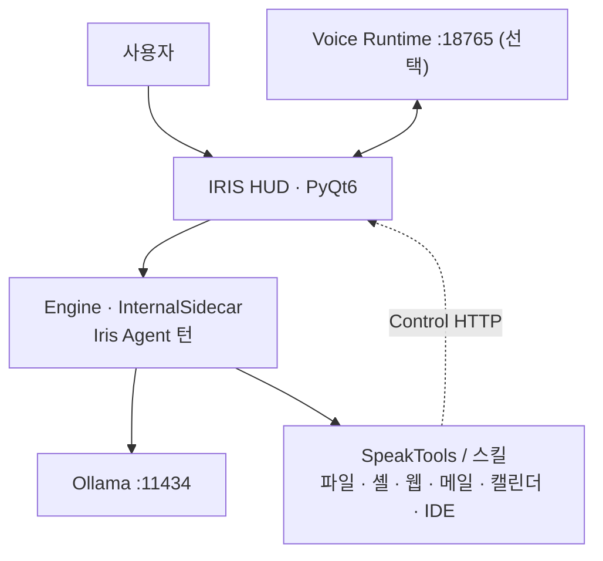

<div align="center">

**🇰🇷 한국어** · [🇺🇸 English](README.en.md) · [🇯🇵 日本語](README.ja.md) · [🇨🇳 中文](README.zh.md)

</div>

# IRIS

**내 PC에서 도는 데스크톱 AI 에이전트**

IRIS는 채팅 HUD · **Iris Agent**(도구·스킬) · **Ollama**(로컬/클라우드 모델)를 한 설치로 묶은 오픈소스 데스크톱 에이전트입니다.
구독형 챗봇이 아니라, 파일·터미널·웹·메일·캘린더·IDE까지 **같은 PC에서 실행**하는 것이 목표입니다.

**Iris Agent**는 IRIS 제품의 독자 에이전트 런타임입니다.
기반 코드는 [Nous Hermes Agent](https://hermes-agent.nousresearch.com/)(MIT)를 흡수·개명한 것이며, 제품 경로에서는 Hermes/외부 `:8642` 게이트웨이에 의존하지 않습니다.
턴 실행은 **내부 sidecar**(Engine)로 돌고, 상태·설정은 `~/.iris-light/`에 둡니다.

[](LICENSE)
[](https://www.python.org/downloads/)
[](#설치)
[](https://github.com/kwakminoo/Project-IRIS-Light/releases/latest)

> 표시 이름 **IRIS** · 패키지 Iris Light · 앱 버전 `0.1.0-light`

🌐 **소개 사이트 — [iris-light-site.vercel.app](https://iris-light-site.vercel.app/)** ([저장소](https://github.com/cjh030906/iris-light-site))

---

## 한 줄로

| 부품 | 역할 |
|------|------|
| **IRIS HUD** (PyQt6) | 채팅 · 모니터 · Wiki · 메일 · 캘린더 · IDE Companion · 설정 |
| **Iris Agent** | 멀티스텝 도구 호출 · 스킬 · 제품 SpeakTools |
| **Ollama** | 로컬/클라우드 모델 추론 (`:11434`) |
| **Voice Runtime** (선택) | STT/TTS FastAPI (`:18765`) |

---

## Demo

**설치부터 동작까지** — 영상 준비 중. 대본은 [`docs/demo-video-script.md`](docs/demo-video-script.md).

검증용 클릭 시나리오: [`docs/검증/기능테스트-시나리오서.md`](docs/검증/기능테스트-시나리오서.md)

```text
사용자 → IRIS HUD → Engine (Iris Agent sidecar) → Ollama / SpeakTools
                              ↓
                    파일 · 셸 · 웹 · 메일 · 캘린더 · IDE
```

---

## Why IRIS?

| 문제 | IRIS |
|------|------|
| 벤더 종속 챗봇 | Ollama · OpenAI 호환 provider를 골라 연결 |
| 에이전트가 UI에 섞임 | Engine/sidecar로 턴 실행을 분리 (제품 경로에 외부 gateway 없음) |
| GPU 없으면 못 씀 | 클라우드 모델 기본, 로컬 모델은 선택 |
| 음성이 앱에 묶임 | Voice Runtime을 별도 서비스로 분리 |
| 설치·연동이 복잡 | Setup.exe / `setup.ps1`이 venv·패키지·시작 위저드까지 처리 |

IRIS는 웹검색·셸·파일 IO를 처음부터 다시 만들지 않습니다.
**세션 · 권한 · 스트리밍 UI · 시작 프로토콜 · 제품 도구 표면**을 담당하고, 추론은 Ollama에, 에이전트 루프는 Iris Agent에 맡깁니다.

---

## Features

| Feature | Description |
|---|---|
| **Iris Agent** | 독자 에이전트 런타임 · 멀티스텝 도구 호출 |
| **SpeakTools** | 홈/IDE 표면별 제품 도구 (`shell.run`, `project.read_file`, 메일·캘린더 등) |
| **Local / Cloud 모델** | Ollama `:11434` · OpenAI 호환 provider |
| **대화형 HUD** | 모델 선택, 이력, 사고/도구 로그, 스트리밍 |
| **워크스페이스** | 모니터 · 메일 · 캘린더 · IRIS IDE Companion · Iris Wiki |
| **Voice** (선택) | STT/TTS `:18765` |
| **로컬 저장** | SQLite · 로그 · 에이전트 홈 (`~/.iris-light/`) |
| **선택 확장** | 화면 학습(Aloha) · Android 에뮬 · mobile-mcp |

---

## Architecture



- 제품 기본 실행: **InternalSidecar** (별도 `:8642` ExternalGateway에 의존하지 않음)
- Iris Agent 설치 트리: `~/.iris-light/agent/` (레거시 `hermes-agent` 폴백은 호환용)
- 설계: [docs/domain.md](docs/domain.md) · [docs/ia/IA.md](docs/ia/IA.md)

---

## Quick Start

**파이썬을 몰라도 설치할 수 있습니다.**

<table>
<tr><td align="center"><b>1</b></td><td><a href="https://github.com/kwakminoo/Project-IRIS-Light/releases/latest/download/IRIS-Setup.exe"><b>IRIS-Setup.exe</b></a> — Windows 10/11</td></tr>
<tr><td align="center"><b>2</b></td><td>실행 → SmartScreen이면 <b>추가 정보 → 실행</b>. venv·패키지는 자동.</td></tr>
<tr><td align="center"><b>3</b></td><td>바탕화면 <b>IRIS</b> 실행 → 시작 위저드가 Ollama · Iris Agent를 안내.</td></tr>
</table>

### 첫 실행

1. 시작 위저드: Ollama · 최소 모델 · Iris Agent · API/provider.
2. Optional(음성·Aloha·에뮬 등)은 「설치」또는 「나중에」.
3. 채팅에 요청을 보내면 Iris Agent 턴이 스트리밍으로 착지합니다.

> 데모 UI만: `IRIS_SETUP_DEMO=1` · 미리보기: `IRIS_SETUP_DRY_RUN=1`

---

## 설치

### 방법 A — 설치 프로그램 (권장)

[**IRIS-Setup.exe**](https://github.com/kwakminoo/Project-IRIS-Light/releases/latest/download/IRIS-Setup.exe)
→ `%LOCALAPPDATA%\Programs\IRIS`. SmartScreen은 **추가 정보 → 실행**.

### 방법 B — 소스 자동 설치

저장소에서 **`setup.bat` 더블클릭** (또는 `.\setup.ps1`).

```powershell
.\setup.ps1              # 기본
.\setup.ps1 -Run         # 설치 후 실행
.\setup.ps1 -Voice       # 음성 런타임까지
.\setup.ps1 -Recreate    # .venv 재생성
```

Linux / macOS: `./setup.sh`

### 방법 C — 수동

```powershell
git clone https://github.com/kwakminoo/Project-IRIS-Light.git
cd Project-IRIS-Light
python -m venv .venv
.\.venv\Scripts\Activate.ps1
pip install -r requirements.txt
copy .env.example .env
```

<details>
<summary><b>설치가 잘 안 될 때</b></summary>

| 증상 | 해결 |
|------|------|
| Python 3.11+ 없음 | [python.org](https://www.python.org/downloads/) · PATH 체크 · `winget install -e --id Python.Python.3.12` |
| `.ps1` 실행 정책 | **`setup.bat` 사용** |
| PyQt6 import 실패 | `winget install -e --id Microsoft.VCRedist.2015+.x64` |
| 앱이 안 뜸 | 설치 폴더 `setup.bat` 재실행 · `%LOCALAPPDATA%\iris-light\launcher.log` |
| 그래도 안 됨 | `.\setup.ps1 -Recreate` |

**권장 사양 (클라우드 모델 위주):** Windows 10/11 · RAM 16GB · GPU 불필요 · 여유 저장 ~20–30GB (로컬 대용량 모델·에뮬 제외).

</details>

---

## 실행

```powershell
.\run.bat
# 또는
python -m iris
```

`dist\IRIS.exe`는 **thin launcher**입니다. 클릭 시 `.venv\Scripts\pythonw.exe -m iris`로 **현재 워크스페이스 최신 소스**를 실행합니다.

```powershell
.\scripts\install_iris_shortcuts.ps1
.\scripts\build_iris_exe.ps1   # 런처/아이콘이 바뀌었을 때
```

---

## Roadmap

완료:

- [x] Iris Agent (흡수·제품 에이전트 · sidecar 턴)
- [x] SpeakTools / Control Surface
- [x] Ollama 로컬·클라우드 모델
- [x] Voice Runtime (선택)
- [x] IRIS IDE Companion · Wiki · 메일 · 캘린더
- [x] Installation (`IRIS-Setup.exe` · setup 스크립트)

계획:

- [ ] Plugin Marketplace
- [ ] Community Agent Skills
- [ ] Multi-Agent Collaboration
- [ ] Cloud Runtime (옵션)

---

## 문서

| 문서 | 설명 |
|------|------|
| [docs/domain.md](docs/domain.md) | 도메인 · 에이전트 경계 |
| [docs/ia/IA.md](docs/ia/IA.md) | 정보 구조 · 요청 경로 |
| [docs/guides/extending-iris.md](docs/guides/extending-iris.md) | 확장 가이드 |
| [docs/검증/기능테스트-시나리오서.md](docs/검증/기능테스트-시나리오서.md) | 기능 시나리오 |
| [docs/voice.md](docs/voice.md) | 음성 |
| [CONTRIBUTING.md](CONTRIBUTING.md) | 기여 |
| [LICENSE.md](LICENSE.md) | 라이선스 · 서드파티 |

<details>
<summary><b>프로젝트 구조 · 스택</b></summary>

```text
iris/                 # 앱 본체
  ui/                 # PyQt6 HUD
  engine/             # Engine · sidecar 턴
  system/             # setup · Iris Agent 설치/동기화 · control
  infrastructure/     # Ollama · Iris Agent 클라이언트 · SpeakTools
  knowledge/          # Wiki
  storage/            # SQLite
services/voice_runtime/  # (선택) STT/TTS
integrations/iris-ide/   # IRIS IDE (Theia 기반)
vendor/iris-agent-runtime/  # Iris Agent pin · overlay
~/.iris-light/        # 런타임 홈 (db · agent · logs)
```

| 구분 | 기술 |
|------|------|
| UI | Python, PyQt6, PyQt6-WebEngine |
| 모델 | Ollama OpenAI 호환 `/v1` |
| 에이전트 | Iris Agent (sidecar · skills · SpeakTools) |
| 음성 | FastAPI (`services/voice_runtime`) |
| 저장 | SQLite (`~/.iris-light/`) |

</details>

---

## 기여

이슈·PR 환영. 절차는 [`CONTRIBUTING.md`](CONTRIBUTING.md).

```powershell
powershell -ExecutionPolicy Bypass -File scripts\run_core_smoke.ps1
```

이 저장소의 기본 개발 흐름은 **로컬에서 수정·검증 → 요청 시에만 `main`에 저장**입니다.

---

## 라이선스

[](LICENSE)

**GPL-3.0-or-later** — [`LICENSE`](LICENSE) · 근거 [`LICENSE.md`](LICENSE.md).

`Copyright (C) 2026 IRIS Project Contributors`

PyQt6(GPL)를 쓰므로 MIT/Apache만으로 배포할 수 없습니다. 상세는 LICENSE.md.

---

## 면책

Iris Agent 도구는 로컬 파일·터미널에 영향을 줄 수 있습니다.
권한·확인 다이얼로그를 확인하세요. 무인 자동화는 사용자 책임입니다.
