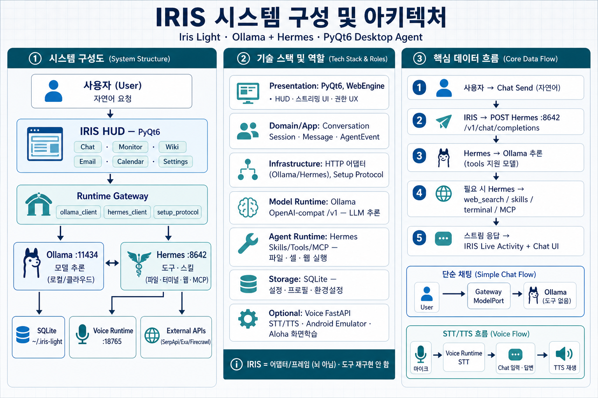
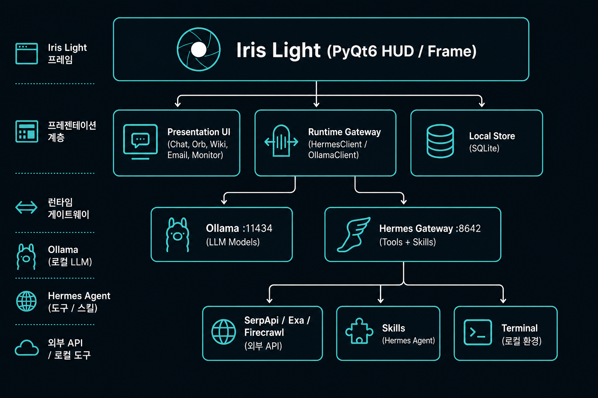
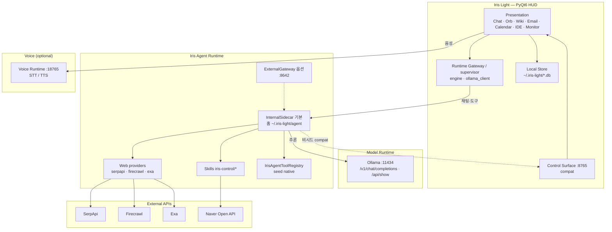

# Iris Light — Information Architecture (IA)

> Generated-at: 2026-10-28  
> 관련 이미지: [iris-system-architecture.png](./iris-system-architecture.png) · [iris-light-ia.png](./iris-light-ia.png)  
> 도메인 정본: [../domain.md](../domain.md)

## 1. 한 줄 정의

**Iris Light는 Ollama(모델)와 Iris Agent(도구·스킬·루프)를 한 제품으로 묶은 데스크톱 HUD**다.  
웹검색·터미널·스킬은 UI가 다시 짜지 않고 **Iris Agent 런타임**이 실행한다. Hermes를 바깥에 두는 wrap 구조가 아니다.

| 질문 | 답 |
|------|-----|
| Iris가 “뇌”인가? | 에이전트 루프·툴 호스트는 **Iris Agent**(제품 소유). HUD는 얼굴·세션·권한 |
| 모델은? | **Ollama** (`:11434`, 로컬/클라우드) |
| 도구·스킬은? | **Iris Agent** (홈 `~/.iris-light/agent`, 기본 InternalSidecar) |
| Iris 역제어? | **Control Surface** (`:8765`) + iris-control MCP — 비시드 compat |
| 음성(선택)? | **Voice Runtime** (`:18765`) |
| 외부 SERP/크롤? | 에이전트 플러그인·스킬 → SerpApi / Exa / Firecrawl 등 |

## 2. 시스템 구성 및 아키텍처

개조식 요약:

- **시스템 구성**: 사용자 → IRIS HUD(PyQt6) → Runtime Gateway / supervisor → Ollama(:11434) + Iris Agent(InternalSidecar) → SQLite · Voice · Control(compat) · External APIs
- **기술 스택·역할**: Presentation(UI) · Runtime(세션·UserTurn) · Infrastructure(어댑터) · Model(Ollama) · Agent(Iris Agent) · Storage(SQLite) · Optional(Voice/Android/Aloha)
- **핵심 데이터 흐름**: Chat/Voice Send → Iris Agent 턴 → Ollama 추론 → native/스킬 도구 → 스트림 UI (단순 채팅은 ModelPort 직행)

## 3. IA 다이어그램

## 4. 레이어 설명

| 레이어 | 책임 | 소유 |
|--------|------|------|
| **Presentation** | HUD, 채팅 스트림, 워크스페이스, 모니터 | Iris |
| **Runtime Gateway** | Ollama/에이전트 어댑터, Setup, supervisor | Iris |
| **Control Surface** | 에이전트→UI 역제어 (`:8765`, compat) | Iris |
| **Model Runtime** | LLM 추론 | Ollama (외부) |
| **Iris Agent Runtime** | tool-calling, 스킬, 웹 백엔드, 루프 | Iris Agent (제품 홈) |
| **Voice Runtime** | STT/TTS (옵션) | Iris `services/voice_runtime` |
| **External APIs** | SERP/크롤/검색 키 | 에이전트 홈 `.env` |

## 5. 사용자 요청 경로 (스타트 → 엔드)

1. 사용자 → Iris Chat Send (또는 음성 UserTurn)  
2. Iris → Iris Agent InternalSidecar (`shared_engine` / 채팅 워커)  
3. Iris Agent → Ollama로 추론 (tools 지원 모델)  
4. 필요 시 native 툴 / 스킬 / (비시드) iris-control → `:8765`  
5. 스트림 → Iris Live Activity + 채팅 UI (+ 옵션 TTS)

옵션: 설정 플래그로 ExternalGateway(`:8642`)만 쓸 수 있다. 제품 기본은 아니다.

## 6. 설정 파일 IA

| 파일 | 내용 |
|------|------|
| 프로젝트 `.env` | `IRIS_OLLAMA_*`, `IRIS_HERMES_*`(레거시 키명·필수 게이트), (선택) `IRIS_CONTROL_*`, `IRIS_AGENT_HOME`, `IRIS_SETUP_*` |
| `~/.iris-light/agent/.env` | 도구·프로바이더 API 키 (Exa, Firecrawl, Naver, API_SERVER_KEY …) |
| `~/.iris-light/agent/config.yaml` | model provider, `web.search_backend` 등 |
| `vendor/iris-agent-runtime/PIN` | 런타임 pin SHA |
| `integrations/hermes-skills/iris-control/` | Iris 역제어 스킬(재배포용) |
| `integrations/hermes-plugins/web/serpapi/` | SerpApi 플러그인 소스 |

구 `%LOCALAPPDATA%\hermes`는 활성 홈이 아니다. 마이그레이션 잔여만 있을 수 있다.

## 7. 관련 문서

- [../domain.md](../domain.md) — 도메인·바운디드 컨텍스트  
- [../api/API-명세서.md](../api/API-명세서.md) — API 엔드포인트 명세  
- [../voice.md](../voice.md) · [../voice_architecture.md](../voice_architecture.md) — 음성  
- Wiki: [[프로젝트 개요]] · [[API 명세서]]
